# Handle

**Product Discovery, Arquitectura Técnica y Roadmap de Desarrollo**

Infraestructura financiera y digitalización comercial para los negocios tradicionales de México: cobrar, administrar y fidelizar clientes desde un solo lugar.

`Hecho para changarros de México` · `Pagos CoDi vía PEY` · `Producto real, no demo`

---

## 🎯 Contexto del proyecto

Queremos continuar desarrollando y evolucionando **Handle** tomando como punto de partida el repositorio:

> 🔗 **GitHub:** [DonCervantes/handle-finanzas-central](https://github.com/DonCervantes/handle-finanzas-central)

El objetivo es transformar la idea inicial en un **producto tecnológico real, escalable, seguro y preparado para operar en el mercado mexicano**.

No queremos seguir con un desarrollo basado solo en prototipos, interfaces simuladas o funcionalidades generadas con *vibe coding*. Queremos una aplicación funcional con:

- Procesos reales.
- Integraciones verificables.
- Persistencia de datos.
- Arquitectura bien definida.
- Una estructura de software que permita evolucionar el producto a largo plazo.

> 💡 **Antes de tocar el código:** analizar a fondo el repositorio actual e identificar qué componentes se **reutilizan**, cuáles se **refactorizan** y cuáles se **desarrollan desde cero**.

Referencia de pagos: la documentación oficial de **PEY**, que será una de las herramientas principales para implementar cobros con **CoDi** en los establecimientos afiliados.

> 🔗 [docs.pey.mx — Create an API key](https://docs.pey.mx/docs/tutorials/getting-started/create-an-api-key/)

---

## ✨ Visión del producto

> **Handle es una plataforma de infraestructura financiera y digitalización comercial diseñada para los negocios tradicionales de México.**

Ayudamos a pequeños y medianos comercios a digitalizar sus operaciones, aceptar pagos digitales, administrar su negocio y construir relaciones duraderas con sus clientes.

### Mercado inicial: los changarros mexicanos

| | Tipo de negocio |
|---|---|
| 🛒 | Abarrotes y tiendas de la esquina |
| 🌮 | Taquerías y restaurantes locales |
| 🥩 | Carnicerías y pollerías |
| 🫓 | Tortillerías |
| ✏️ | Papelerías |
| 💊 | Farmacias independientes |
| ☕ | Cafeterías |
| 🏠 | Comercios familiares y negocios independientes |

Muchos de estos negocios no tienen sistemas de administración, conocimientos técnicos avanzados ni infraestructura tecnológica. Por eso la experiencia debe ser **sencilla, intuitiva, accesible** y diseñada para sus condiciones reales de operación.

> 🧭 **No es otro punto de venta genérico.** Es un ecosistema que conecta **comercios**, **consumidores** y **servicios financieros**.

---

## 🧩 Módulos principales

| # | Módulo | En una línea |
|---|---|---|
| 1 | 🔐 **Identidad y onboarding** | Autenticación real, roles y varios usuarios por negocio. |
| 2 | 🪪 **KYC / KYB** | Verificación del negocio y cuestionario que define sus herramientas. |
| 3 | 💸 **Pagos PEY + CoDi** | Cobros reales por QR y Push, confirmados en backend. |
| 4 | 🏪 **Red de afiliados** | Perfiles públicos y alta de comercios por registro o invitación. |
| 5 | 🎁 **Lealtad y recompensas** | Puntos por comercio con ledger auditable. |
| 6 | 🗺️ **Mapa de comercios** | Mapa interactivo con coordenadas reales. |
| 7 | 📊 **Dashboard del comercio** | Panel modular que se adapta a cada negocio. |
| 8 | 🛡️ **Panel de administración** | Operación central del equipo Handle. |

### 🔐 Módulo 1 · Identidad, autenticación y onboarding

Sistema de autenticación real para distintos tipos de usuario.

- Registro e inicio de sesión.
- Recuperación de contraseña.
- Verificación de correo electrónico.
- Verificación de número telefónico.
- Gestión de sesiones.
- Control de acceso basado en roles (**RBAC**).
- Perfiles de usuarios.
- Perfiles de establecimientos.
- Asociación de múltiples usuarios a un mismo negocio.

> 📌 **Decisión pendiente:** definir la tecnología de autenticación y justificar por qué.

### 🪪 Módulo 2 · KYC / KYB y clasificación de negocios

Onboarding y verificación de los establecimientos que se integran a Handle. No basta con verificar al propietario: hay que conocer cómo opera y se administra cada negocio.

**Información a recopilar (KYB):**

| Identidad y fiscal | Operación | Contacto y pagos |
|---|---|---|
| Nombre comercial | Tipo de establecimiento | Información de contacto |
| Razón social (si aplica) | Actividad económica | Cuenta o medio de recepción de pagos |
| RFC | Ubicación física | Métodos de pago actuales |
| Régimen fiscal | Número de sucursales | |
| Propietario o representante legal | Transacciones aproximadas | |
| Documentación de identidad | Cantidad de empleados | |
| Comprobante de domicilio | Necesidades administrativas | |

**Cuestionario inteligente:** identifica qué herramientas necesita realmente cada negocio.

| Negocio | Herramientas sugeridas |
|---|---|
| Negocio pequeño | Cobros digitales · Historial de transacciones · Programa de puntos |
| Carnicería | Inventario · Control de productos · Registro de ventas · Reportes de ingresos |
| Taquería | Administración de pedidos · Control de ventas · Reportes diarios · Recompensas |

> 💡 La evaluación inicial puede usar **reglas determinísticas y formularios configurables**. No hace falta IA desde el primer día.

> ⚠️ **Recopilar ≠ verificar.** Un negocio que solo llenó un formulario **no** se muestra como verificado. La verificación documental y la decisión de aprobación son pasos aparte.

**Estados del proceso:**

`Pendiente` → `En revisión` → `Aprobado` · `Rechazado` · `Requiere información adicional`

### 💸 Módulo 3 · Infraestructura de pagos — PEY + CoDi

Recepción de pagos real mediante PEY. Dos modalidades a explorar:

| A · Pago con QR | B · Pago Push |
|---|---|
| Generación de solicitudes de pago | Solicitud de pago |
| Generación y visualización del QR | Flujo de autorización correspondiente |
| Identificación del establecimiento receptor | Confirmación de la operación |
| Asociación del pago con una venta | Asociación con comercio y transacción |
| Consulta del estado de la transacción | |
| Confirmación por mecanismos oficiales de PEY | |

**Requisitos no negociables:**

- ❌ No simular pagos exitosos.
- ❌ No confiar únicamente en respuestas del frontend.
- ✅ Validación en backend.
- ✅ Webhooks o los mecanismos de confirmación disponibles.
- ✅ Idempotencia.
- ✅ Estados: `pendiente` · `exitoso` · `rechazado` · `expirado`.
- ✅ Registro de auditoría.
- 🔒 No almacenar información sensible de autenticación de usuarios bancarios.

> 🔎 **Investigar antes de implementar:** capacidades reales de PEY, endpoints, requisitos de integración, ambiente de pruebas, restricciones operativas y condiciones comerciales. **No asumir** que todas las modalidades están disponibles bajo las mismas condiciones.

### 🏪 Módulo 4 · Red de afiliados y comercios locales

Cada establecimiento afiliado cuenta con:

- Perfil público, nombre comercial y descripción.
- Categoría y fotografías.
- Ubicación geográfica, horarios e información de contacto.
- Beneficios disponibles y estado de afiliación.
- Puntuación o reputación *(si se implementa después)*.

Un sistema de administración permite a Handle incorporar y gestionar comercios. Los negocios pueden **registrarse directamente** o ser **invitados por un administrador**.

### 🎁 Módulo 5 · Programa de lealtad y recompensas

Sistema de puntos para que cada comercio recompense a sus clientes.

> 🧾 **Ejemplo:** un cliente compra **$150 MXN** en una tienda afiliada. La política del comercio es *1 punto por cada $10 MXN* y *100 puntos = $10 MXN de descuento*. El cliente gana **15 puntos** y los usa en compras futuras.

**Funcionalidades:**

- Cuenta de puntos del consumidor.
- Historial de acumulación y de redenciones.
- Reglas configurables por comercio.
- Cupones y promociones.
- Recompensas por recurrencia.
- Beneficios exclusivos para clientes frecuentes.

**Principios de diseño:**

- 📒 **Ledger de puntos:** nunca modificar saldos directamente sin registrar el movimiento.
- 🏷️ Los puntos pertenecen al **establecimiento que los emite**, salvo un futuro programa compartido.
- 🛡️ **Antifraude:** evitar acumulaciones duplicadas, cancelaciones indebidas y redenciones no autorizadas.

### 🗺️ Módulo 6 · Mapa de comercios

Mapa geográfico real e interactivo. **Sin ubicaciones estáticas ni marcadores ficticios**: solo comercios afiliados con sus coordenadas reales.

- Comercios cercanos.
- Búsqueda por categorías y filtros por beneficios.
- Información del establecimiento.
- Navegación hacia el negocio.
- Geolocalización del usuario **con su autorización**.
- Promociones cercanas.

Los administradores pueden incorporar negocios recomendados desde el panel central.

> 📌 **Evaluar:** Mapbox, MapLibre u OpenStreetMap, comparando costos, licenciamiento, límites de uso y facilidad de integración.

### 📊 Módulo 7 · Dashboard del establecimiento

Panel privado, **modular**, que se adapta al tipo de negocio y sus necesidades.

| Iniciales | Futuras |
|---|---|
| Resumen de ventas | Inventario |
| Historial de transacciones | Control de proveedores |
| Recepción de pagos | Gestión de gastos |
| Generación de QR | Control de caja |
| Gestión de puntos | Administración de sucursales |
| Historial de clientes | Facturación e integración fiscal |
| Reportes de ingresos | Reportes avanzados |
| Configuración del establecimiento | Inteligencia de negocio |
| Gestión de usuarios y empleados | |

> 💡 No construir todo desde el inicio. La arquitectura permite **habilitar módulos** según lo que se detecte en el onboarding.

### 🛡️ Módulo 8 · Panel de administración general

Panel central para el equipo de Handle, con **roles y permisos específicos** para administradores.

| Comercios | Operación | Plataforma |
|---|---|---|
| Gestionar comercios | Consultar transacciones | Administrar usuarios |
| Revisar solicitudes de afiliación | Monitorear operaciones | Gestionar categorías |
| Administrar verificaciones | Gestionar incidencias | Administrar el mapa |
| Aprobar o rechazar establecimientos | Consultar métricas generales | Gestionar promociones |
| Incorporar negocios recomendados | | |

---

## 🛠️ Definición tecnológica

Antes de programar: evaluar tecnologías y proponer un stack moderno, mantenible y escalable.

| Capa | A considerar |
|---|---|
| **Frontend** | React · Next.js o alternativa justificada · TypeScript · Tailwind CSS · componentes reutilizables · responsive y mobile-first |
| **Backend** | API REST · TypeScript · arquitectura modular · validación de datos · servicios por dominio · webhooks · procesamiento de pagos |
| **Base de datos** | PostgreSQL · Supabase (BD + auth) · diseño relacional · migraciones · Row Level Security cuando corresponda |
| **Infraestructura** | Cloudflare Workers · Pages o Workers para frontend · R2 para archivos · DNS · gestión segura de variables y secretos |
| **Mapas** | MapLibre · OpenStreetMap · proveedor de geocodificación |
| **Pagos** | PEY · CoDi |

> ⚖️ **No elegir por popularidad.** Cada decisión se justifica por costo, complejidad, escalabilidad, seguridad, ecosistema y compatibilidad.

> 🧪 Definir también qué servicios corren **localmente** en desarrollo y cuáles se conectan a **servicios externos de prueba**.

---

## 📚 Documentación a generar

### A · PDR — Product Requirements Document

Visión · Problema · Mercado objetivo · Perfiles de usuario · Propuesta de valor · Casos de uso · Requerimientos funcionales · Requerimientos no funcionales · Alcance del MVP · Funcionalidades futuras · Indicadores de éxito · Riesgos y restricciones.

### B · TDR — Technical Design Requirements

Stack · Arquitectura general · Componentes · Estructura del backend · Modelo de datos · Integraciones externas · Autenticación · Seguridad · Infraestructura · Despliegue · Testing · Escalabilidad.

### C · Diagramas de arquitectura (Mermaid)

1. Arquitectura general del sistema.
2. Arquitectura del backend.
3. Flujo de autenticación.
4. Flujo de onboarding y KYB.
5. Flujo de pago mediante CoDi.
6. Flujo de acumulación y redención de puntos.
7. Relación entre usuarios, comercios y administradores.
8. Modelo entidad-relación de la base de datos.

### D · Business Model Canvas

Segmentos de clientes · Propuesta de valor · Canales · Relación con clientes · Fuentes de ingresos · Recursos clave · Actividades clave · Socios clave · Estructura de costos.

**Modelos de monetización a investigar:**

| Modelo | Nota |
|---|---|
| Suscripción mensual | |
| Comisión por transacción | Solo si el modelo y los contratos de pago lo permiten |
| Planes premium | |
| Herramientas administrativas adicionales | |
| Servicios de valor agregado | |

> ⚠️ Ningún ingreso se da por viable hasta **validar los acuerdos con los proveedores de pagos**.

---

## 📣 Landing page

Contenido y estructura dirigidos al mercado mexicano. Lenguaje **cercano, profesional y fácil de entender** para el comerciante tradicional, sin exceso de tecnicismos ni jerga fintech.

> **Mensaje central:** Handle ayuda a tu negocio a **cobrar**, **administrar** y **fidelizar** a tus clientes desde un solo lugar.

**Entregables:**

- [ ] Slogan principal *(proponer varios y elegir el mejor)*
- [ ] Propuesta de valor
- [ ] Hero section y subtítulo
- [ ] Llamadas a la acción
- [ ] Sección de beneficios
- [ ] Cómo funciona
- [ ] Funcionalidades principales
- [ ] Sección para comercios afiliados
- [ ] Sección de recompensas para consumidores
- [ ] Preguntas frecuentes
- [ ] Footer
- [ ] Mensajes de confianza
- [ ] Identidad verbal de marca

> 🚫 **No prometer** funcionalidades, certificaciones o alianzas que todavía no estén implementadas. Mantener el nombre **Handle** y construir una marca reconocible en México.

---

## 🎫 Metodología: construcción por tickets

Nada de desarrollar toda la plataforma en un solo bloque. El proyecto se divide en **épicas → módulos → milestones → tickets**.

### Anatomía de un ticket

| Campo | Campo |
|---|---|
| ID | Archivos o módulos afectados |
| Nombre | Criterios de aceptación |
| Descripción | Pruebas necesarias |
| Objetivo | Prioridad |
| Justificación | Estimación de complejidad |
| Dependencias | Definición de terminado (DoD) |

Cada ticket debe poder **implementarse, probarse y revisarse de forma independiente**, ordenado por dependencias.

### 🗺️ Roadmap por fases

```mermaid
%%{init: {'theme':'base','themeVariables':{'fontFamily':'General Sans, Satoshi, system-ui, sans-serif','primaryColor':'#ECE5D8','primaryTextColor':'#1A1815','primaryBorderColor':'#B8A179','lineColor':'#B8A179','tertiaryColor':'#F5F1E8','background':'#F5F1E8'}}}%%
flowchart LR
    F0["FASE 0<br/>Auditoría y definición"] --> F1["FASE 1<br/>Fundamentos"]
    F1 --> F2["FASE 2<br/>Onboarding y KYB"]
    F2 --> F3["FASE 3<br/>Comercios y admin"]
    F3 --> F4["FASE 4<br/>Pagos"]
    F4 --> F5["FASE 5<br/>Lealtad"]
    F5 --> F6["FASE 6<br/>Geolocalización"]
    F6 --> F7["FASE 7<br/>Inteligencia"]
    F7 --> F8["FASE 8<br/>Producción"]

    classDef ink fill:#1A1815,stroke:#1A1815,color:#F5F1E8;
    classDef gold fill:#B8A179,stroke:#B8A179,color:#1A1815;
    class F0 ink;
    class F4 gold;
```

| Fase | Enfoque | Alcance |
|---|---|---|
| **0** | 🔍 Auditoría y definición | Análisis del repositorio · deuda técnica · definición del producto · arquitectura · selección tecnológica |
| **1** | 🧱 Fundamentos | Inicialización · configuración local · base de datos · autenticación · roles y permisos · estructura de API |
| **2** | 🪪 Onboarding y KYB | Registro de comercios · formularios · documentación · clasificación · flujo de aprobación |
| **3** | 🏪 Comercios y administración | Dashboard del comercio · panel administrativo · sucursales · perfiles públicos |
| **4** | 💸 Pagos | Integración PEY · credenciales · QR · Push *(sujeto a capacidades verificadas)* · webhooks · historial |
| **5** | 🎁 Lealtad | Sistema de puntos · ledger · reglas · redenciones · promociones |
| **6** | 🗺️ Geolocalización | Mapa · geocodificación · comercios cercanos · filtros · perfil público |
| **7** | 🤖 Inteligencia y administración | Inventarios · reportes · analítica · automatizaciones · funcionalidades avanzadas |
| **8** | 🚀 Producción | Auditoría de seguridad · pruebas integrales · optimización · Cloudflare · CI/CD · monitoreo · despliegue |

---

## 📏 Reglas de ingeniería

| # | Regla |
|---|---|
| 1 | No modificar el repositorio sin una auditoría previa. |
| 2 | No inventar endpoints, integraciones ni funcionalidades de terceros. |
| 3 | Consultar documentación oficial antes de integrar servicios externos. |
| 4 | No usar datos ficticios en funcionalidades que se presenten como reales. |
| 5 | Mocks solo en pruebas automatizadas o entornos de desarrollo claramente identificados. |
| 6 | No almacenar contraseñas ni secretos en texto plano. |
| 7 | Validación tanto en frontend como en backend. |
| 8 | Control de acceso en el servidor. |
| 9 | Migraciones para cualquier cambio en la base de datos. |
| 10 | Documentar las decisiones arquitectónicas. |
| 11 | Pruebas unitarias, de integración y end-to-end. |
| 12 | Separación entre desarrollo, staging y producción. |
| 13 | No exponer claves privadas ni API keys en el frontend. |
| 14 | Logs y auditoría para operaciones financieras. |
| 15 | Priorizar la seguridad y consistencia de las transacciones. |
| 16 | Código limpio, tipado y modular. |
| 17 | Evitar sobreingeniería y microservicios prematuros. |
| 18 | No avanzar de fase sin validar los criterios de aceptación de la anterior. |

**Estado de toda funcionalidad:**

`Planificada` → `En desarrollo` → `Implementada` → `Probada` → `Desplegada`

---

## 🚦 Primera tarea: análisis y estrategia

> ⛔ **Por ahora no se programa ni se modifican archivos del repositorio.**

### Entregables del análisis

| # | Entregable | # | Entregable |
|---|---|---|---|
| 1 | Diagnóstico del repositorio actual | 9 | Arquitectura general |
| 2 | Solidez de la idea de negocio | 10 | Diagramas del backend |
| 3 | Problemas que resuelve Handle en México | 11 | PDR |
| 4 | Competidores y alternativas | 12 | TDR |
| 5 | Propuesta de diferenciación | 13 | Business Model Canvas |
| 6 | Riesgos comerciales, técnicos, financieros y regulatorios | 14 | Identidad verbal y contenido de la landing |
| 7 | Definición del MVP | 15 | Roadmap completo |
| 8 | Propuesta tecnológica justificada | 16 | Backlog inicial de tickets *(empezando por fundamentos)* |

### Equipo multidisciplinario

| Rol | Rol |
|---|---|
| 📈 Product Manager fintech | 💳 Especialista en pagos digitales mexicanos |
| 🏗️ CTO / arquitectura de software | 🪪 Especialista en KYC/KYB y cumplimiento |
| ⚙️ Ingeniero backend | 🎨 Diseñador UX/UI |
| 🖥️ Ingeniero frontend | 🧭 Consultor de negocios y estrategia |

> 🎯 **El objetivo no es una demo bonita**, sino una plataforma que un comerciante real en México pueda usar, que resuelva problemas reales y que pueda convertirse en un negocio sostenible.

**Empecemos por entender qué tenemos, qué queremos construir y cómo debemos hacerlo correctamente.**

---

## 🎨 Anexo · Identidad gráfica de Handle

Tokens tomados del repositorio original (`src/styles.css`), para que todo entregable mantenga la misma identidad.

### Tipografía

| Uso | Fuente | Fallback | Fuente original |
|---|---|---|---|
| Texto y títulos | **General Sans** (400 · 500 · 600 · 700) | Satoshi, system-ui, sans-serif | Fontshare |
| Números, código, datos | **Geist Mono** (400 · 500) | ui-monospace, monospace | Google Fonts |

- Títulos (`h1`–`h3`) con *letter-spacing* de **−0.025em**.
- Cifras con `tabular-nums` para que los montos se alineen.
- Radio base de **0.75rem** en tarjetas y botones.

### Paleta (modo claro)

| Token | Hex | OKLCH | Uso |
|---|---|---|---|
| `background` | `#F5F1E8` | 0.959 0.013 86.8 | Fondo crema |
| `foreground` / `primary` | `#1A1815` | 0.21 0.007 78.2 | Tinta: texto y botones primarios |
| `card` | `#ECE5D8` | 0.924 0.019 83.1 | Tarjetas |
| `gold` | `#B8A179` | 0.719 0.061 81.2 | Acento de marca, foco, gráfica principal |
| `muted-foreground` | `#8C8475` | 0.616 0.024 83.2 | Texto secundario |
| `border` | `#E2D9C8` | 0.888 0.025 83.4 | Bordes |
| `accent` | `#E5D6BA` | 0.88 0.04 82 | Hover y resaltes |
| `success` | `#5B7F4E` | 0.556 0.084 137.7 | Pago exitoso / aprobado |
| `warning` | `#C08A3E` | 0.672 0.113 72.9 | Pendiente / en revisión |
| `destructive` | `#B94739` | 0.55 0.15 30 | Rechazado / error |
| `info` | `#57768C` | 0.55 0.05 240 | Información |

> 🌙 Existe también un **modo oscuro** con la misma lógica cálida (fondo `oklch(0.17 0.008 75)`, oro `oklch(0.76 0.065 81.2)`).

### Voz

- Español mexicano, cercano y claro.
- Frase de marca: ***Toda tu operación, en una sola mano.***

---

Handle — Toda tu operación, en una sola mano.

